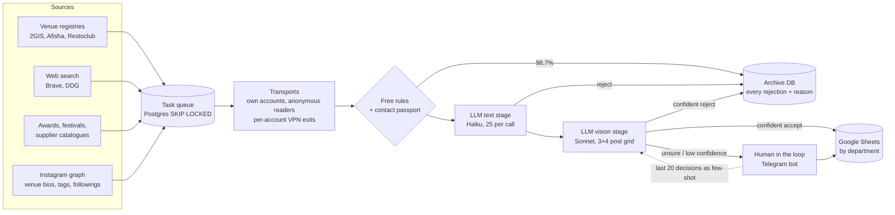

# llm-lead-qualifier

**A production LLM pipeline that finds and qualifies B2B leads around the clock: free rules first,
then a two-stage Claude cascade (text → vision), then a human in the loop. Every stage is measured
against human labels.**

[Русская версия](README.ru.md)

The client sells premium tableware to restaurants. Its sales team wanted a steady stream of people who
*decide* what plates a kitchen buys: head chefs, pastry chefs and, in some regions, restaurant owners and
HoReCa suppliers. These people live on Instagram, mixed in with millions of food bloggers, home bakers,
consultants, venue accounts and people who changed jobs last year.

This system reads ~50,000 profiles a day from 15+ sources. It rejects 98.7% of them with free rules, sends
the remaining ~0.5% to Claude, routes the doubtful ones to a person in Telegram, and exports the result to
Google Sheets, split by sales department.

| Headline numbers (15 days in production) | |
|---|---|
| Profiles read → leads delivered | 781,751 → **1,100** (≈73 per day) |
| Share of profiles that ever reach an LLM | **0.53%** (vision model: 0.2%) |
| LLM calls per delivered lead | **≈0.8** (848 calls in total) |
| Precision of accepted leads vs. client labels | **85%** (95% CI 81–88), n = 541 |
| Recall of the cheap text stage | **95%** (92–97). It filters without losing leads |
| Schema-valid structured output | 99.1% text, 99.8% vision |
| Doubtful verdicts routed to a human | 38% of vision verdicts (confidence < 0.75) |
| Cost spread between lead sources | **190×** (12 vs. 2,284 profiles read per lead) |
| Tests | 770 (pytest, real Postgres) |

Full methodology and tables: [docs/RESULTS.md](docs/RESULTS.md) (Russian: [docs/METRICS.ru.md](docs/METRICS.ru.md)).
A file-by-file code guide (in Russian): [docs/CODE_MAP.ru.md](docs/CODE_MAP.ru.md).

---

## How it works



1. **Sources produce candidates.** Venue registries supply restaurants with a price level. Web search
   bridges a venue name to its Instagram account. Venue bios name their chefs ("Бренд-шеф @…"). Tags and
   followings expand the graph. `sources/refill.py` rotates sources automatically when one dries up.
2. **Workers read profiles** through a Postgres task queue (`FOR UPDATE SKIP LOCKED`). Each Instagram
   account has its own VPN exit, an hourly request cap and per-endpoint cooldowns
   (`access/health.py`). Cheap read-only work goes to anonymous readers, so logged-in accounts are kept for
   the endpoints that need a session.
3. **Free rules** (`qualify/rules.py`, `qualify/roles.py`, `qualify/vetting.py`) decide most profiles
   without any model:
   - Is a target role written in the bio?
   - Is this a venue account rather than a person?
   - Courses, catering or home baking?
   - Not working right now?
   - Does the venue have the required price level?
   - Has the profile posted within 6 months?
   - Which sales department owns the city?
4. **The contact passport** (`qualify/passport.py`) settles three questions the client cared about after
   reviewing an export:
   - **Country.** It weighs foreign place names, domains, handle suffixes, Ukrainian letters and the 🇺🇦 flag
     against Russian signals.
   - **Venue or person.** It catches "the restaurant names its chef" accounts.
   - **Duplicates.** It finds the same person under two handles.
5. **LLM cascade** (`llm/grader.py`):
   - **Text stage.** Claude Haiku reads bio + 12 captions for 25 profiles per call and answers
     `pass | reject | unsure` with a one-line reason. It is tuned for recall and is cheap enough to run on
     everything the rules let through.
   - **Vision stage.** Claude Sonnet looks at a 3×4 grid of the last 12 posts
     (`qualify/grid.py`, one image instead of 12, which is 12× fewer image inputs) next to reference grids of
     an ideal and a borderline profile. It returns `accept | reject | unsure`, a confidence and a
     `strong_profile` flag.
   - **Routing.** A reject becomes final only if confidence ≥ 0.75 *and* the grid has ≥ 6 tiles. Everything
     doubtful goes to a human.
6. **Human in the loop** (`ops/bot.py`). Disputed profiles arrive as Telegram cards with "take / reject"
   buttons. The last 20 human decisions are injected into the vision prompt as few-shot examples, so the
   model follows the client's taste without retraining.
7. **Export** (`ops/exporter.py`, `ops/sheet.py`) writes to Google Sheets per department. Every
   rejection is kept in a separate archive DB with its reason, so any rule change can be replayed against
   history.

## LLM design decisions

| Decision | Why |
|---|---|
| **Rules before models** | 98.7% of profiles are decided for free. The LLM budget goes to the 0.5% where judgement matters. |
| **Cascade: small text model → large vision model** | Haiku filters on text at ~10 profiles per call before Sonnet spends an image call. Text-stage recall is 95%, so the filter rarely loses a lead. |
| **3×4 post grid as one image** | The visual bar ("plated dishes, not infographics") is judged from 12 posts in one input instead of 12 images. |
| **JSON-schema structured output** | `--json-schema` with enums for verdicts. Unknown handles in a response are ignored, a response with no known handle stops the loop, and a failed call is logged and never turned into a verdict. |
| **Confidence threshold + abstention** | Low confidence, `unsure` or a thin grid goes to a human. The model never makes a final call it is not sure of. |
| **Few-shot from live human decisions** | The prompt adapts to the client's taste every day without fine-tuning. |
| **Role prompts in the DB** | Each role (chef, pastry chef, consultant, dealer) carries its own requirements in `role_profiles`. A new role is a row, not a deploy. |
| **Frozen predictions for eval** | Grader verdicts are stored before the human decides, so the eval measures the model, not the human confirming it. |
| **Daily call cap + 24/7 loop** | `grader_daily_calls` bounds spend. The grader runs as a service that drains the queue continuously. |

## Evals

There are two complementary eval suites.

### 1. Production eval on human labels (private data, public aggregates)

`evals/build_gold.py` → `evals/predict.py` → `evals/run.py`

- **Gold set.** The client's last decision per profile in the bot (541 profiles).
- **Per-component scoring.** Rules, the text stage, the vision stage and the whole system each get
  precision, recall and F1 with **Wilson 95% intervals**. On a few hundred examples a single point
  estimate is misleading.
- **Regression set.** Every contact the client flagged in a real export becomes a permanent test case.
- **Economics.** Profiles read per delivered lead, per source channel.
- **Stability.** Checkpoints per 1,000 requests before and after an operational change (see the
  rejected hypothesis in [docs/RESULTS.md](docs/RESULTS.md#4-a-hypothesis-the-data-rejected)).

The gold set contains real people's profiles, so it never leaves the machine (`evals/data/private/` is
git-ignored). Only aggregates are published.

### 2. Synthetic behavioural eval (public, reproducible)

`evals/synthetic.py` generates **330 invented profiles in 22 slices**. Every handle starts with `syn_`.
The slices include:

- the target: chef, pastry chef, Latin-script bio, trained abroad, born abroad, mixed personal/work feed;
- abroad: Ukraine, Kazakhstan, Uzbekistan, Georgia;
- venue accounts, including a venue that names its chef;
- courses, catering, private chefs, former chefs;
- slices that only judgement can catch: consultants, food bloggers, travel chefs.

`evals/offline.py` runs the production rules and the production LLM prompt on them:

```bash
python -m evals.offline          # rules + cached LLM verdicts, no API calls
python -m evals.offline --llm    # re-query Claude and refresh the cache
```

| Stage | Precision | Recall | F1 |
|---|---|---|---|
| Rules alone | 67% (58–74) | 86% (78–91) | 75% |
| LLM text stage alone | 54% (47–61) | 100% (96–100) | 70% |
| **Cascade** | **100% (96–100)** | 86% (78–91) | **92%** |

Neither stage is good alone. Rules know geography and venue accounts, while the LLM catches bloggers,
travel chefs and consultants. Rejections are combined with an OR, so the cascade inherits the strengths of
both. The per-slice table is in [`evals/results/synthetic_report.md`](evals/results/synthetic_report.md).

#### Prompt iteration, measured

The first synthetic run showed the LLM **passing 15 of 15 restaurant consultants** whose role was "chef".
The cause was the prompt's exception "a consultant without a venue is fine *for the consulting role*". The
model generalised it to every role. The fix scoped the exception to its role. A rerun of all 330 cases
gave:

| | Prompt v1 | Prompt v2 |
|---|---|---|
| `consultant_no_venue` (LLM) | 0% | **100%** |
| Cascade precision | 86% | **100%** |
| Regressions on accept slices | — | none |

v1 is kept in `evals/results/synthetic_report_prompt_v1.md` and `evals/data/synthetic_llm_prompt_v1.jsonl`.

#### A known failure the eval surfaced (not fixed yet)

`chef_bio_booking_cta`: a chef's *personal* bio such as "Бренд-шеф @venue · бронь в директ" is mistaken for
a venue account that names its chef. The "booking" wording is a venue signal. Rules reject all 15. The LLM
gets them right, but the cascade cannot recover a rules reject. The case is kept in the suite as the next
target: either soften the rule or route this pattern to the LLM instead of rejecting.

## Code map

```
leadgen/
  core/      storage and plumbing: Postgres (main + archive), schemas, task queue, settings, alerts, replica, backups
  access/    Instagram access: transports (logged-in / anonymous / HikerAPI), account pool, endpoint health,
             hourly caps, per-account VPN exits
  sources/   lead sources: 2GIS / Afisha / Restoclub registries, web search, awards, festivals, suppliers,
             graph expansion, automatic source rotation (refill)
  qualify/   task handlers, role catalogue, free rules, vetting, contact passport (geo / abroad / duplicates),
             name parsing, the 12-post grid
  llm/       grader: text + vision cascade, schemas, routing, few-shot, daily cap
  ops/       worker pool, Telegram bot (human in the loop), Sheets export, watchdog + morning report
evals/       gold set builder, predictors, metrics (Wilson CI), production report, synthetic eval
tests/       770 tests against a real throw-away Postgres (pgserver or $LEADGEN_TEST_PG)
deploy/      docker-compose services and a launchd setup for a single Mac
```

The big modules to start reading are `llm/grader.py`, `qualify/vetting.py`, `qualify/passport.py`,
`ops/workers.py` and `sources/websearch.py`.

## Running it

```bash
python -m venv .venv && . .venv/bin/activate
pip install -r requirements.txt
python -m pytest -q          # starts a temporary Postgres via pgserver
python -m evals.offline      # synthetic eval, no network
```

To run the full system, copy `.env.example` to `.env` and fill in the database URLs, the Telegram bot
token, the Google service account and `CLAUDE_CODE_OAUTH_TOKEN`. Then:

```bash
docker compose up -d   # archive-db, workers, registry, grader, bot, backup
```

Secrets live only in `.env` and `secrets/`. Both are git- and docker-ignored, and `tests/test_compose.py`
checks that `.env.example` contains keys but no values.

## Stack

Python 3.9+, PostgreSQL (psycopg 3; Supabase for the main DB), Claude via Claude Code CLI with JSON-schema
output (Haiku for text, Sonnet for vision), httpx with SOCKS, xray for VPN exits, Pillow for the post grids,
Telegram Bot API, Google Sheets (gspread + Apps Script), Docker Compose / launchd, pytest, GitHub Actions.

## Responsible use

This is a portfolio copy of a system built for one client. Instagram's terms restrict automated access.
The code reads only public profile data, rate-limits itself per account and never bypasses captchas
or anti-bot challenges. Account credentials, cookies and session files are not part of this repository.
The fixtures and the synthetic dataset are invented. No real person's data is published here.

## License

MIT
